<div align="center">

[한국어](README.md) | **日本語**

# 🤖 第3次スーパーロボット大戦 韓国語パッチ

スーパーファミコン **「第3次スーパーロボット大戦」**（1993）のセリフ、メニュー、ステージタイトル、タイトルロゴまでを韓国語に翻訳した非公式ファンパッチ

[](https://github.com/game-patch-ko/srw3-ko/releases)
[](#-パッチの当て方)
[](#-パッチの当て方)
[](#-仕組み)
[](#-フォントとライセンス)

[**ダウンロード**](https://github.com/game-patch-ko/srw3-ko/releases) · [パッチの当て方](#-パッチの当て方) · [不具合の報告](#-不具合の報告) · [仕組み](#-仕組み) · [ビルド方法](#-自分でビルドする) · [権利について](#-権利について)

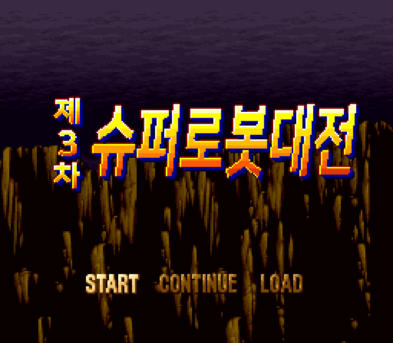

</div>

## ✨ 特徴

| | |
|---|---|
| 📝 **ゲーム全体を翻訳** | セリフ、プロローグ・エンディング、パイロット・ユニット・武器名、地形、メニューやウィンドウの文言まで、3,489個の断片を翻訳しました。 |
| 🔤 **完成形ハングル2,350字** | ROMを2MBに拡張し、KS X 1001の完成形ハングル2,350字を12pxのドットフォントMonaS12で収録しました。字数を削った組み合わせ方式ではありません。 |
| 🎬 **グラフィック文字も** | ステージ導入タイトル51個（「제1화 『암운』」＝「第1話『暗雲』」）とタイトルロゴをハングルで描き直しました。 |
| 🗣️ **キャラクターごとの口調** | 十三の関西弁は慶尚道方言に、ギャリソンの丁寧語は「~사옵니다」に、ジャックの英語混じりの口調はそのまま再現しました。 |
| 📐 **画面幅に合わせた改行** | ゲームの行幅の上限（会話240px、戦闘200px）を実測し、すべてのセリフをその範囲に収めました。 |
| 🩹 **元のROMはそのまま** | 配布するのはxdelta・IPSパッチだけです。元のROMではなくコピーに当てます。 |

## 🖼️ スクリーンショット

### 原文との比較

<table>
  <tr>
    <th>原文</th>
    <th>韓国語パッチ</th>
  </tr>
  <tr>
    <td>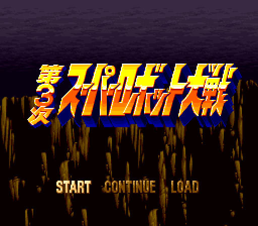</td>
    <td></td>
  </tr>
  <tr>
    <td>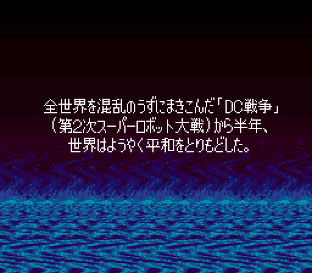</td>
    <td>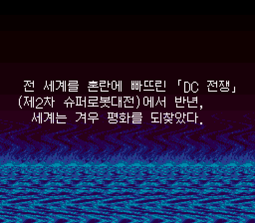</td>
  </tr>
  <tr>
    <td>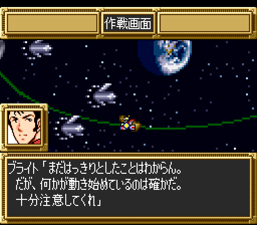</td>
    <td>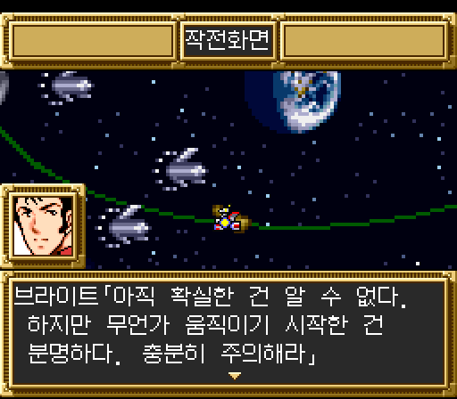</td>
  </tr>
  <tr>
    <td>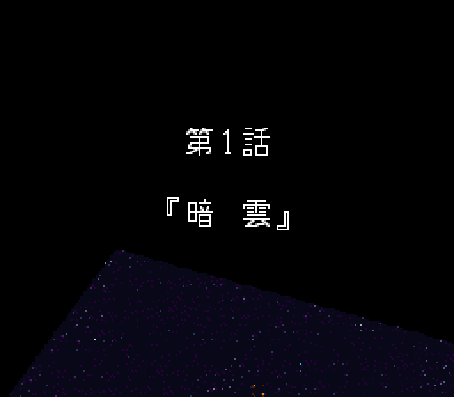</td>
    <td>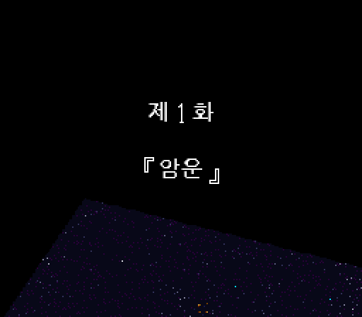</td>
  </tr>
  <tr>
    <td>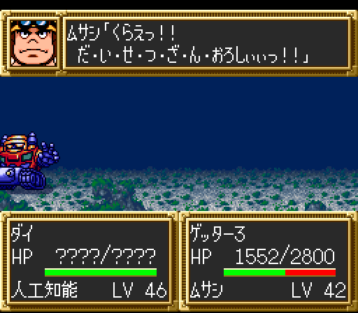</td>
    <td>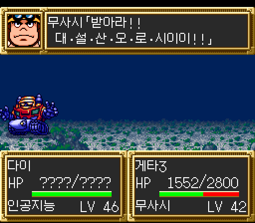</td>
  </tr>
</table>

### メニューとインターミッション

<table>
  <tr>
    <td>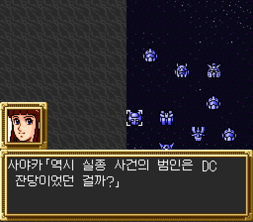</td>
    <td>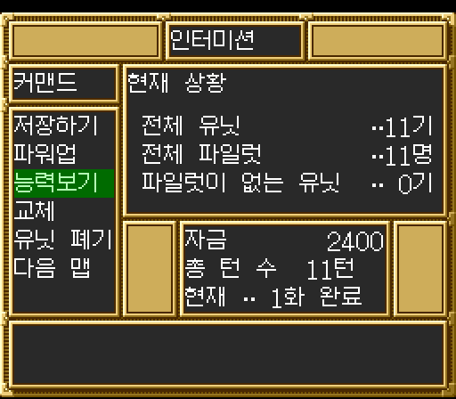</td>
  </tr>
  <tr>
    <td align="center">マップ上の会話</td>
    <td align="center">インターミッションメニューと現在の状況</td>
  </tr>
  <tr>
    <td>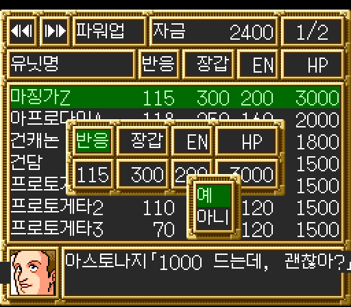</td>
    <td>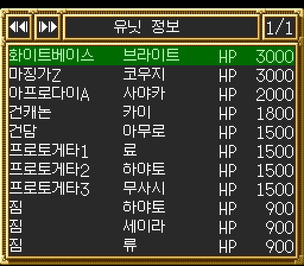</td>
  </tr>
  <tr>
    <td align="center">パワーアップ（改造費用の確認）</td>
    <td align="center">ユニット情報</td>
  </tr>
  <tr>
    <td>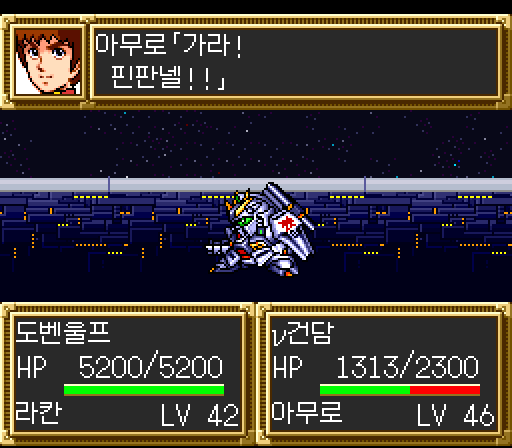</td>
    <td>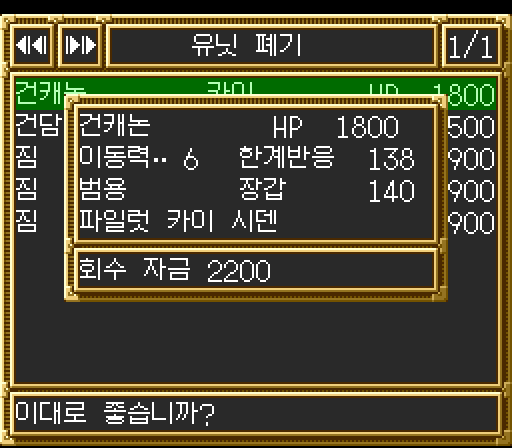</td>
  </tr>
  <tr>
    <td align="center">戦闘画面</td>
    <td align="center">ユニット廃棄</td>
  </tr>
</table>

## 🚀 パッチの当て方

### 1. 元のROMを確認する

ご自身でお持ちの元のROMが必要です。このリポジトリとリリースにROMは含まれていません。

| 項目 | 値 |
|---|---|
| ファイル | `Dai-3-Ji Super Robot Taisen (J).smc`（名前は違っていても構いません） |
| サイズ | 1,572,864バイト（ヘッダなし） |
| CRC32 | `DFE9CC90` |
| SHA-1 | `b16375f0c1cc6e5960cbcd2f9d24d97cb824c5d4` |

> [!WARNING]
> サイズが **1,573,376バイト** の場合、先頭に512バイトのコピー機ヘッダが付いています。ヘッダを削除してからパッチを当ててください。
> xdeltaはヘッダ付きROMをエラーで拒否しますが、**IPSはエラーを出さずに「成功」と表示し、壊れたROMを作ってしまいます。**

### 2. xdeltaでパッチを当てる（推奨）

[リリース](https://github.com/game-patch-ko/srw3-ko/releases)から `srw3_ko.xdelta` をダウンロードします。元のROMをコピーし、コピーの方に当ててください。

| 方法 | 使い方 |
|---|---|
| 🌐 **ウェブ** | [Rom Patcher JS](https://www.marcrobledo.com/RomPatcher.js/) でROMと `srw3_ko.xdelta` を選び、**Apply patch** |
| 🖱️ **Windowsアプリ** | Delta Patcherで元のROMと `srw3_ko.xdelta` を選び、**Apply patch** |
| ⌨️ **コマンドライン** | 下記のコマンド（[xdelta3](https://github.com/jmacd/xdelta-gpl/releases)） |

```bash
xdelta3 -d -s "Dai-3-Ji Super Robot Taisen (J).smc" srw3_ko.xdelta srw3_ko.smc
```

### 3. 結果を確認する

| 項目 | 値 |
|---|---|
| サイズ | 2,097,152バイト（2MB） |
| CRC32 | `906E0742` |
| SHA-1 | `e675eb578dc69e16738e1f4683fadb302444835d` |

できあがった `srw3_ko.smc` をエミュレータでそのまま開きます。

> [!TIP]
> **IPSのソフトパッチ:** Mesenやsnes9xなどは、ROMと同じフォルダに同じ名前の `.ips` があると起動時に自動で適用します（例: `srw3.smc` + `srw3.ips`）。この方法にも対応していますが、ヘッダの問題を防げるxdeltaをおすすめします。

> [!IMPORTANT]
> セーブデータやステートセーブを元のROMと混ぜて使わないでください。ROMのサイズとテキストの位置が違うため、元のROMのステートセーブを読み込むと画面が崩れることがあります。

## 🐞 不具合の報告

誤訳、不自然な文、文字化け、ウィンドウからのはみ出し、フリーズなどを見つけたら、[**Issueで教えてください**](https://github.com/game-patch-ko/srw3-ko/issues/new/choose)。GitHubアカウントがあればどなたでも登録でき、フォームに沿って書くだけです。日本語で書いていただいて構いません。

| 一緒に教えていただけると助かるもの | 理由 |
|---|---|
| 📸 **スクリーンショット** | 画面の文から翻訳スクリプトの該当箇所をすぐに探せます |
| 📍 **場面**（何話のどの画面か） | 同じ文が複数の場所にある場合に区別できます |
| 💾 **ステートセーブ**（.mssなど、zipで添付） | その場面をそのまま再現し、修正結果を確認できます |
| 🎮 **エミュレータとパッチの当て方** | 特定のエミュレータだけで起きる問題を切り分けます |

> [!TIP]
> 特に **エンディング**、**サウンドテストの曲名**、**第3話以降のステージタイトル** は、まだ実際の画面で確認できていません。この部分のスクリーンショットは、問題がなくても大いに役立ちます。

## 🏆 やったこと

### 翻訳範囲

| 区分 | 内容 | 規模 |
|---|---|---|
| 💬 **セリフ** | ステージの会話、作戦画面、戦闘セリフ | セリフスクリプト14個 |
| 🏷️ **名前・用語** | パイロットのフルネーム・略称、ユニット、武器、地形、曲名、コマンド、武器属性 | 表9個 |
| 🪟 **ウィンドウの文言** | システムメニュー、能力画面、インターミッション、精神コマンドの説明、プロローグ・エンディングの文章 | レイアウト3個 |
| 🎬 **グラフィック文字** | ステージ導入タイトル、タイトルロゴ | タイトル51個、ロゴ1個 |

### 表記の方針

- 韓国で広く知られている表記に従い、ゲッターは **게타**（ゲタ）に統一しました。
- 武器・技名は、武器表でもセリフでも分かち書きせずに続けて書きます（例: `갓브레이커`＝ゴッドブレイカー、`로켓펀치`＝ロケットパンチ）。
- 階級は大佐を대령、少佐を소령、大尉を대위、中尉を중위、少尉を소위と訳しました。
- 精神コマンドのド根性・ひらめきは、32pxの欄に収めるため **투혼**（闘魂）・**직감**（直感）と訳しました。

### 作業の流れ

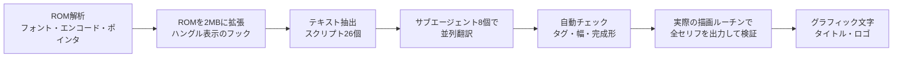

## 🔍 仕組み

元のゲームは1バイトのかなと2バイトの漢字を使います。パッチは漢字の代わりに、新しく割り当てた2バイトコードでハングルを描画させます。

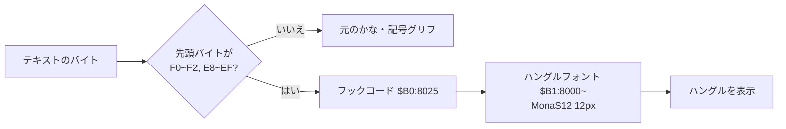

| 対象 | 変更内容 |
|---|---|
| ROMサイズ | 1.5MB → 2MB（LoROM拡張、バンク `$B0~$BF`） |
| 文字の解釈 | セリフ `$81:85AF`、ウィンドウテキスト `$80:C82D`、文字列出力 `$81:EDF6` の3か所をフック |
| ハングルフォント | KS X 1001の2,350字、ドットフォントMonaS12（12px）を変換、`$B1:8000~` |
| テキスト配置 | 訳文をバンク `$B4~$BF` に再配置し、セリフブロック表 `$80:D2D7`、名前・ウィンドウレイアウト表 `$80:D277` を書き換え |
| ステージタイトル | 16×16スプライトフォント（LZ圧縮）をナヌムゴシック15pxのハングルで作り直し、スプライトのまとまり51個を書き直し |
| タイトルロゴ | BG2のタイル207個に「제3차 슈퍼로봇대전」を描き直し（ナヌムスクエア ExtraBold） |

<details>
<summary><b>リバースエンジニアリングの詳細</b></summary>

- 2バイトの先頭バイト `F0 F1 F2 E8~EF` の下にある2,816マスに、完成形2,350字を配置しています。
- `.` `,` は、和文の `。`（E4）・`、`（3A）の位置に韓国語用の形を描き直して使っています。
- 行幅の上限は `$0E34`（4px単位）です。会話ウィンドウは60単位（240px）、戦闘ウィンドウは50単位（200px）で、超えるとゲームはその文字を捨てて改行します（`$81:85C4`）。ビルドはこの値で全セリフの幅をチェックします。
- 実行中にパイロット名を挿入する `{name:xx}` はハングル4字（48px）として計算します。
- ステージタイトルのフォントはグラフィック資料表 `$10:8000` の3番（`$20:C182`、LZ圧縮で32KB）で、LZ展開ルーチン `$80:885A` と同じ形式の圧縮器を自作しました（元の資料4個で往復・サイズ一致を確認）。
- タイトルロゴはグラフィック資料5番（`$21:CA18`）で、タイルマップはそのままにタイルの絵だけを差し替えています。

</details>

## ✅ 検証

| チェック | 方法 | 結果 |
|---|---|---|
| ビルドの再現性 | 2回ビルドした結果のMD5を比較 | 一致 |
| 再配置の回帰 | 翻訳なしで再配置だけしたROMと、フックだけのROMで描画された文字コードの記録を比較 | 1,070字が完全一致 |
| 全セリフの出力 | Mesen2のLuaでセリフの断片を順に実際の描画ルーチンへ流して出力 | 通常セリフ11ファイル・戦闘セリフ3ファイルを最後まで出力、行あふれ0件 |
| ウィンドウレイアウト | システムメニューの位置でレイアウト410個を差し替えて描画 | 404個を出力、文字化けなし |
| 実プレイ | 第1話クリア後のインターミッションメニュー全体 | 正常 |
| パッチの適用 | xdelta3 3.1.0・Flips v198で元のROMに適用し、パッチ済みROMだけをMesen2で読み込み | ビルドしたROMとSHA-1が一致、タイトル〜第1話まで正常 |
| ほかのエミュレータ | snes9x 1.63、bsnes v115でタイトルとデモ戦闘 | 正常 |

> [!NOTE]
> 動作を確認したエミュレータはMesen2 2.1.1、snes9x 1.63、bsnes v115です。実機、エンディングの実際の進行、サウンドテストの曲名、第3話以降のステージタイトルはまだ確認していません。一部のウィンドウで長い名前が枠に触れることがあります。

## 🤖 作業方法: 人が指揮したAIハーネス

このパッチは、**人が方針と表記を決め、AIハーネス [Claude Code](https://claude.com/claude-code) 上でClaudeが解析・実装・翻訳・検証を担当して** 作りました。

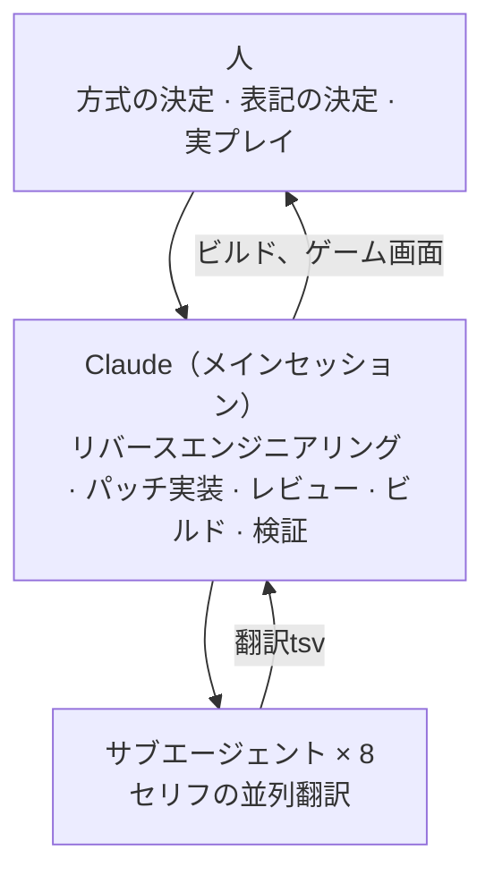

| 役割 | 担当 | やったこと |
|---|---|---|
| 🧑 **指揮** | 人 | ROM拡張・完成形方式、フォントの選定（MonaS12）、表記の決定、実プレイとフィードバック |
| 🧠 **統括** | Claude | 65816のリバースエンジニアリング、フック・フォント・グラフィックのパッチ、抽出・挿入ツール、翻訳のレビュー、自動検証 |
| ✍️ **翻訳** | Claudeのサブエージェント | 翻訳ガイドラインに沿って、セリフをファイルごとに分けて並列翻訳 |

AIが出した訳文をそのまま使ってはいません。タグの順序、完成形かどうか、行幅、残ったかな・漢字をツールでチェックし、実際の描画ルーチンで全セリフを出力して画面で確認しました。

## 🛠️ 自分でビルドする

<details>
<summary><b>ビルド方法を開く</b></summary>

| 必要なもの | 内容 |
|---|---|
| Python 3 | `Pillow` |
| 元のROM | リポジトリのルートに `Dai-3-Ji Super Robot Taisen (J).smc` |
| セリフ・メニューのフォント | [MonaS12](https://github.com/MonadABXY/mona-font) のリリース `2026.10.09` の `MonaFont-ttf.zip` を `tools/fonts/mona/` に展開（`MonaS/01 Main/MonaS12.ttf`）。別の場所なら環境変数 `SRW3_MONAS12` でファイルを指定 |
| タイトル・ロゴのフォント | ナヌムゴシック（`NanumGothic.ttf`）、ナヌムスクエア ExtraBold（`NanumSquareEB.ttf`）。既定ではWindowsのユーザーフォントフォルダから探します。別の場所にある場合は環境変数 `SRW3_FONTDIR` でフォルダを指定 |

```bash
cd build
python srwtext.py build
```

結果は `out/srw3_ko.smc` と `out/srw3_ko.ips` に出力されます。配布用のxdeltaは次のように作ります。

```bash
xdelta3 -e -9 -s "Dai-3-Ji Super Robot Taisen (J).smc" out/srw3_ko.smc srw3_ko.xdelta
```

- 翻訳は `script/*.txt` の `KO:` 行を編集します。ルールは各ファイルの冒頭にあります。
- 分岐タグ（`{if}` `{goto}` `{rand}` `{F8:..}`）と `{END}` の位置が原文と違うと、ビルドが止まります。
- 作業の引き継ぎ文書は [HANDOFF.md](HANDOFF.md)、解析文書は `analysis/` にあります（どちらも韓国語）。

</details>

## 📁 リポジトリの構成

```text
├── analysis/    ROM解析の文書とツール（文字表、ポインタ調査、65816逆アセンブラ、LZ圧縮器）
├── build/       パッチのビルド（抽出・挿入、フック・フォント、ステージタイトル、タイトルロゴ）
├── script/      翻訳スクリプト26個（セリフ dlg*、名前 sys*、ウィンドウレイアウト lay*）— 原文（JP:）と訳文（KO:）を対照
├── tr/          翻訳補助ツールと翻訳元のtsv
├── tools/       Mesen2自動検証用のLuaとスクリプト生成ツール
├── dist/        配布パッケージのREADME.txtとOFL.txt
├── docs/images/ READMEのスクリーンショット
└── HANDOFF.md   作業の引き継ぎ文書
```

`script/` と `tr/` には、翻訳の対照と校正のために日本語の原文も含まれています。元のROM、ビルドしたROM、エミュレータはリポジトリに含めていません。パッチファイルはReleaseの添付ファイルとして配布します。

## 🔤 フォントとライセンス

| 使用箇所 | フォント | 制作 |
|---|---|---|
| セリフ・メニュー・名前（12px） | [MonaS12](https://github.com/MonadABXY/mona-font) | Monad ABXY |
| ステージ導入タイトル（15px） | [ナヌムゴシック](https://hangeul.naver.com/font) | NAVER |
| タイトルロゴ | ナヌムスクエア ExtraBold | NAVER |

いずれもSIL Open Font License 1.1で配布されているフォントを白黒ビットマップに変換して収録しています。著作権表示とライセンス全文はリリースの `OFL.txt` にあります。v0.9ではセリフ・メニューにもナヌムゴシックを使っていましたが、v0.9.1からドットフォントMonaS12に変更しました。

## ⚖️ 権利について

- **目的:** 第3次スーパーロボット大戦が好きな韓国のファンのために、純粋にファンの立場で作りました。営利目的はなく、無料で提供します。
- **権利:** 原作および登場作品・キャラクターのすべての権利は各権利者に帰属します。このパッチは非公式であり、権利者の承認を受けていません。制作者はこのパッチについていかなる排他的権利も主張しません。
- **ROMは含みません:** 配布するのはパッチファイルだけで、ROMは配布しません。パッチを当てるには、ご自身でお持ちの元のROMが必要です。
- **提供の中止:** 権利者から要請があった場合、パッチの提供を中止することがあります。
- **対応について:** 制作者は会社勤めの一般人です。不具合の報告への対応が遅れることがありますので、ご了承ください。

## 📢 AI利用の告知

このプロジェクトは、AnthropicのAIモデルであるClaudeと一緒に制作しました。責任は作成者にあります。

This project was made together with Claude, an AI model by Anthropic. The author is responsible for it.
