<div align="center">

**한국어** | [日本語](README.ja.md)

# 🤖 제3차 슈퍼로봇대전 한국어 패치

슈퍼 패미컴 **「第3次スーパーロボット大戦」**(1993)의 대사, 메뉴, 스테이지 제목, 타이틀 로고까지 한국어로 옮긴 비공식 팬 패치

[](https://github.com/game-patch-ko/srw3-ko/releases)
[](#-패치-방법)
[](#-패치-방법)
[](#-어떻게-동작하나요)
[](#-글꼴과-라이선스)

[**다운로드**](https://github.com/game-patch-ko/srw3-ko/releases) · [패치 방법](#-패치-방법) · [동작 원리](#-어떻게-동작하나요) · [직접 빌드](#-직접-빌드) · [권리와 안내](#-권리와-안내)

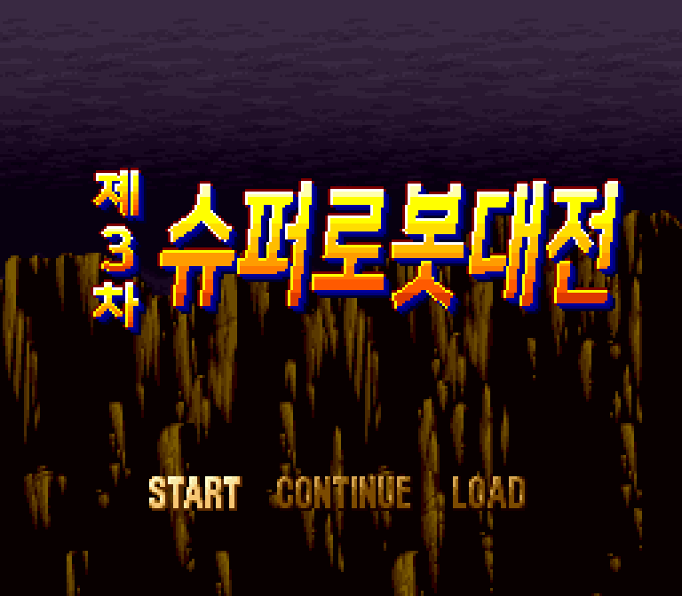

</div>

## ✨ 특징

| | |
|---|---|
| 📝 **게임 전체 번역** | 대사, 프롤로그·엔딩, 파일럿·유닛·무기 이름, 지형, 메뉴와 창 문구까지 3,489개 조각을 번역했습니다. |
| 🔤 **완성형 한글 2,350자** | ROM을 2MB로 늘리고 KS X 1001 완성형 2,350자를 나눔고딕 12px로 넣었습니다. 글자를 줄여 쓰는 조합 방식이 아닙니다. |
| 🎬 **그래픽 글자까지** | 스테이지 도입 제목 51개(「제1화 『암운』」)와 타이틀 로고를 한글로 다시 그렸습니다. |
| 🗣️ **인물별 말투** | 쥬조의 간사이 사투리는 경상도 말씨로, 개리슨의 정중한 말투는 `~사옵니다`로, 잭의 영어 섞인 말투는 그대로 살렸습니다. |
| 📐 **화면 폭에 맞춘 줄바꿈** | 게임의 줄 폭 한도(대화 240px, 전투 200px)를 실측해 모든 대사를 그 안에 맞췄습니다. |
| 🩹 **원본은 그대로** | xdelta·IPS 패치만 배포합니다. 원본 ROM을 직접 고치지 않고 복사본에 적용합니다. |

## 🖼️ 스크린샷

### 원문과 비교

<table>
  <tr>
    <th>원문</th>
    <th>한국어 패치</th>
  </tr>
  <tr>
    <td>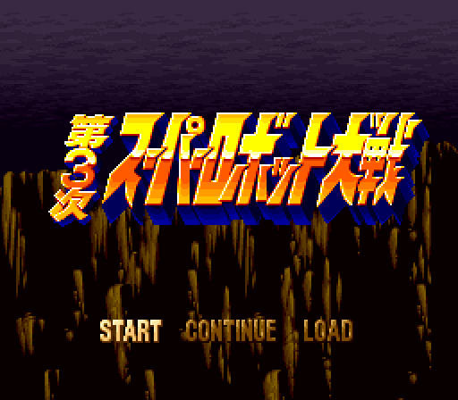</td>
    <td></td>
  </tr>
  <tr>
    <td>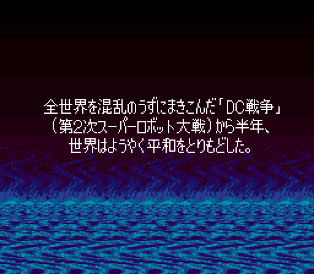</td>
    <td>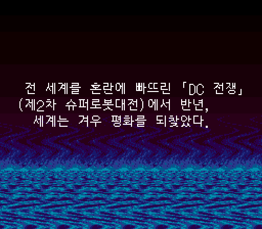</td>
  </tr>
  <tr>
    <td>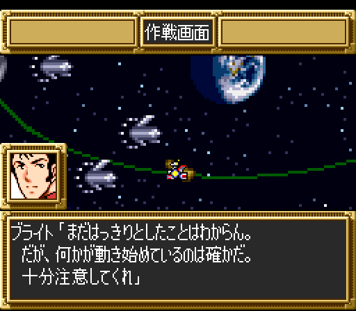</td>
    <td>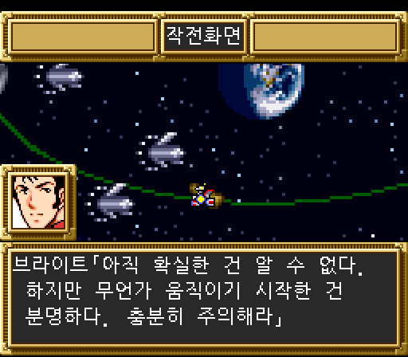</td>
  </tr>
  <tr>
    <td>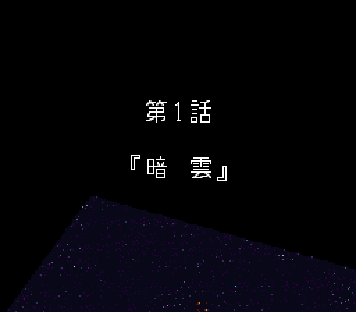</td>
    <td>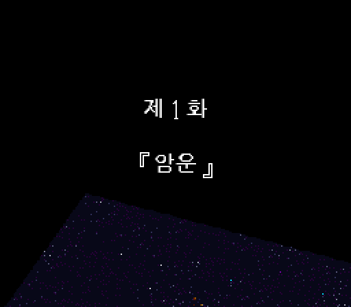</td>
  </tr>
  <tr>
    <td>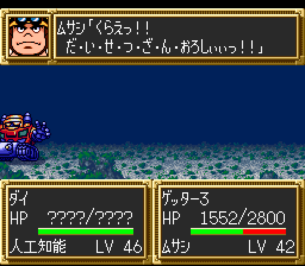</td>
    <td>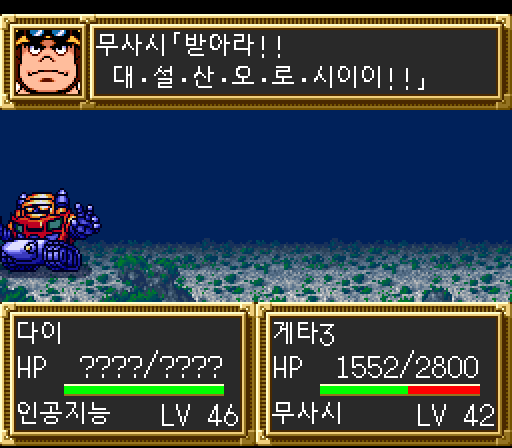</td>
  </tr>
</table>

### 메뉴와 인터미션

<table>
  <tr>
    <td>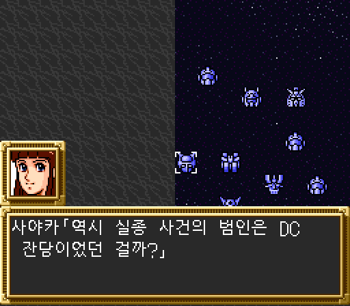</td>
    <td>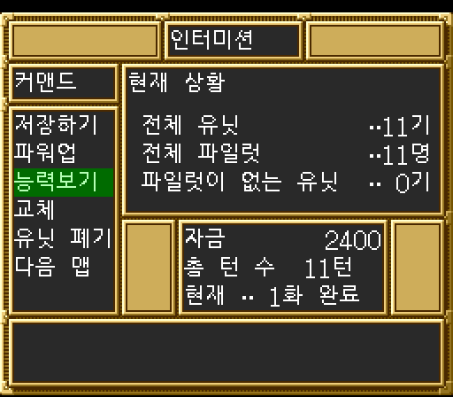</td>
  </tr>
  <tr>
    <td align="center">지도 위 대화</td>
    <td align="center">인터미션 메뉴와 현재 상황</td>
  </tr>
  <tr>
    <td>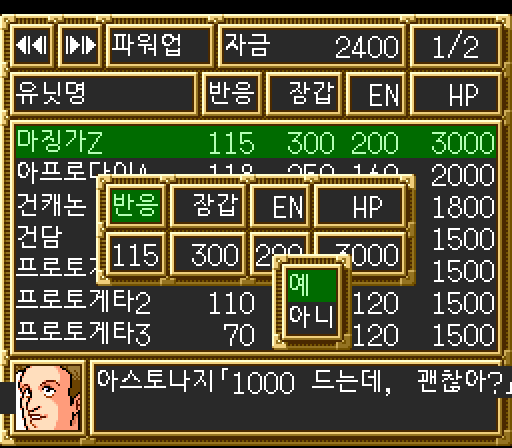</td>
    <td>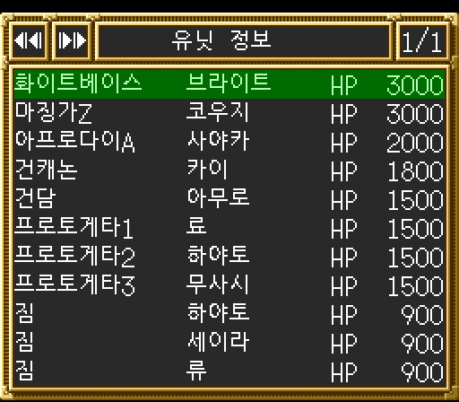</td>
  </tr>
  <tr>
    <td align="center">파워업(개조 비용 확인)</td>
    <td align="center">유닛 정보</td>
  </tr>
  <tr>
    <td>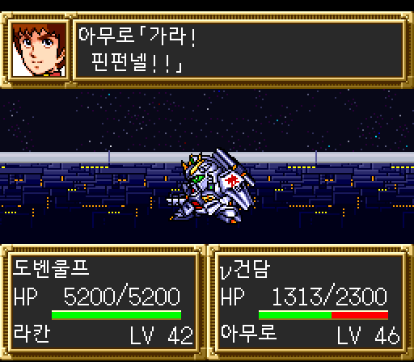</td>
    <td>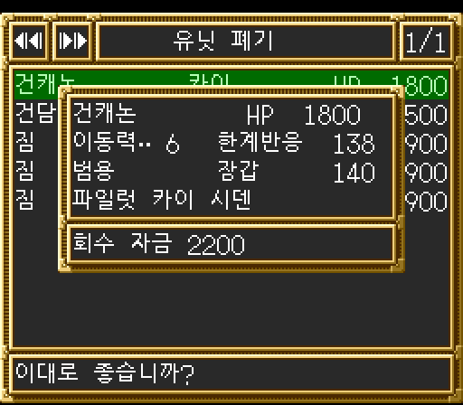</td>
  </tr>
  <tr>
    <td align="center">전투 화면</td>
    <td align="center">유닛 폐기</td>
  </tr>
</table>

## 🚀 패치 방법

### 1. 원본 ROM 확인

직접 가지고 있는 원본 ROM이 필요합니다. 이 저장소와 릴리스에는 ROM이 없습니다.

| 항목 | 값 |
|---|---|
| 파일 | `Dai-3-Ji Super Robot Taisen (J).smc` (이름은 달라도 됩니다) |
| 크기 | 1,572,864바이트 (헤더 없음) |
| CRC32 | `DFE9CC90` |
| SHA-1 | `b16375f0c1cc6e5960cbcd2f9d24d97cb824c5d4` |

> [!WARNING]
> 크기가 **1,573,376바이트**이면 앞에 512바이트 복사기 헤더가 붙은 ROM입니다. 헤더를 지운 뒤 패치하세요.
> xdelta는 헤더 붙은 ROM을 오류로 거부하지만, **IPS는 오류 없이 "성공"이라고 하면서 망가진 ROM을 만듭니다.**

### 2. xdelta로 패치 (권장)

[릴리스](https://github.com/game-patch-ko/srw3-ko/releases)에서 `srw3_ko.xdelta`를 받습니다. 원본 ROM을 복사해 두고 복사본에 적용하세요.

| 방법 | 사용법 |
|---|---|
| 🌐 **웹** | [Rom Patcher JS](https://www.marcrobledo.com/RomPatcher.js/)에서 ROM과 `srw3_ko.xdelta`를 고르고 **Apply patch** |
| 🖱️ **Windows 프로그램** | Delta Patcher에서 원본 ROM과 `srw3_ko.xdelta`를 고르고 **Apply patch** |
| ⌨️ **명령줄** | 아래 명령 ([xdelta3](https://github.com/jmacd/xdelta-gpl/releases)) |

```bash
xdelta3 -d -s "Dai-3-Ji Super Robot Taisen (J).smc" srw3_ko.xdelta srw3_ko.smc
```

### 3. 결과 확인

| 항목 | 값 |
|---|---|
| 크기 | 2,097,152바이트 (2MB) |
| CRC32 | `AEDB3DCB` |
| SHA-1 | `c1097046518c36a228a91f820b6d56e8be1d7de2` |

만든 `srw3_ko.smc`를 에뮬레이터에서 바로 엽니다.

> [!TIP]
> **IPS 소프트 패치:** Mesen, snes9x 등은 ROM과 같은 폴더에 같은 이름의 `.ips`가 있으면 실행할 때 자동으로 적용합니다(예: `srw3.smc` + `srw3.ips`). 이 방법도 지원하지만, 헤더 문제를 막아 주는 xdelta를 먼저 권합니다.

> [!IMPORTANT]
> 세이브와 상태 저장은 원본 ROM과 섞어 쓰지 마세요. ROM 크기와 텍스트 위치가 달라서 원본의 상태 저장을 불러오면 화면이 깨질 수 있습니다.

## 🏆 한 일

### 번역 범위

| 구분 | 내용 | 규모 |
|---|---|---|
| 💬 **대사** | 스테이지 대화, 작전 화면, 전투 대사 | 대사 스크립트 14개 |
| 🏷️ **이름·용어** | 파일럿 풀네임·약칭, 유닛, 무기, 지형, 곡명, 커맨드, 무기 속성 | 표 9개 |
| 🪟 **창 문구** | 시스템 메뉴, 능력 화면, 인터미션, 정신 커맨드 설명, 프롤로그·엔딩 문장 | 레이아웃 3개 |
| 🎬 **그래픽 글자** | 스테이지 도입 제목, 타이틀 로고 | 제목 51개, 로고 1개 |

### 표기 원칙

- 국내에 널리 알려진 표기를 따르되, ゲッター는 **게타**로 통일했습니다.
- 무기·기술 이름은 무기 표와 대사 모두 붙여 씁니다(예: `갓브레이커`, `로켓펀치`).
- 계급은 大佐 대령, 少佐 소령, 大尉 대위, 中尉 중위, 少尉 소위로 옮겼습니다.
- 정신 커맨드 ド根性·ひらめき는 32px 칸에 맞춰 **투혼**·**직감**으로 옮겼습니다.

### 작업 과정

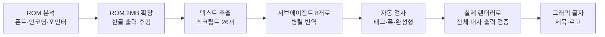

## 🔍 어떻게 동작하나요

원래 게임은 1바이트 가나와 2바이트 한자를 씁니다. 패치는 한자 자리 대신 새로 정한 2바이트 코드로 한글을 그리게 합니다.

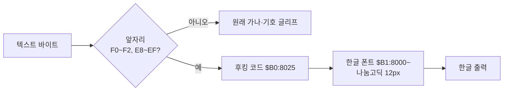

| 대상 | 변경 내용 |
|---|---|
| ROM 크기 | 1.5MB → 2MB (LoROM 확장, 뱅크 `$B0~$BF`) |
| 글자 해석 | 대사 `$81:85AF`, 창 텍스트 `$80:C82D`, 문자열 출력 `$81:EDF6` 세 곳을 후킹 |
| 한글 폰트 | KS X 1001 2,350자, 나눔고딕 12px 흑백 변환, `$B1:8000~` |
| 텍스트 배치 | 번역문을 뱅크 `$B4~$BF`에 다시 배치하고 대사 블록 표 `$80:D2D7`, 이름·창 레이아웃 표 `$80:D277`을 고침 |
| 스테이지 제목 | 16×16 스프라이트 글꼴(LZ 압축)을 한글로 다시 만들고 스프라이트 묶음 51개를 새로 씀 |
| 타이틀 로고 | BG2 타일 207개에 「제3차 슈퍼로봇대전」을 다시 그림(나눔스퀘어 ExtraBold) |

<details>
<summary><b>역공학 상세</b></summary>

- 2바이트 앞자리 `F0 F1 F2 E8~EF` 아래 2,816칸에 완성형 2,350자를 배치합니다.
- `.` `,`는 일본식 `。`(E4)·`、`(3A) 자리에 한국어 모양을 다시 그려 씁니다.
- 줄 폭 한도는 `$0E34`(4px 단위)입니다. 대화창은 60단위(240px), 전투창은 50단위(200px)이고, 넘으면 게임이 그 글자를 버리고 줄을 바꿉니다(`$81:85C4`). 빌드는 이 값으로 모든 대사의 폭을 검사합니다.
- 실행 중 파일럿 이름을 넣는 `{name:xx}`는 한글 4자(48px)로 계산합니다.
- 스테이지 제목 글꼴은 그래픽 자료 표 `$10:8000`의 3번(`$20:C182`, LZ 압축 32KB)이고, LZ 해제기 `$80:885A`와 같은 형식의 압축기를 직접 작성했습니다(원본 자료 4개로 왕복·크기 일치 확인).
- 타이틀 로고는 그래픽 자료 5번(`$21:CA18`)이며 타일맵은 그대로 두고 타일 그림만 바꿉니다.

</details>

## ✅ 검증

| 검사 | 방법 | 결과 |
|---|---|---|
| 빌드 재현성 | 두 번 빌드한 결과의 MD5 비교 | 같음 |
| 재배치 회귀 | 번역 없이 재배치만 한 ROM과 후킹만 한 ROM에서 그려진 글자 코드 기록 비교 | 1,070자 완전 일치 |
| 전체 대사 출력 | Mesen2 Lua로 대사 조각을 차례로 실제 게임 렌더러에 흘려 출력 | 일반 대사 11개·전투 대사 3개 파일 끝까지 출력, 줄 넘침 0건 |
| 창 레이아웃 | 시스템 메뉴 자리에서 레이아웃 410개를 바꿔 그림 | 404개 출력, 글자 깨짐 없음 |
| 실제 플레이 | 1화 클리어 후 인터미션 메뉴 전체 | 정상 |
| 패치 적용 | xdelta3 3.1.0·Flips v198로 원본에 적용, 패치한 ROM만 Mesen2에 로드 | 빌드 ROM과 SHA-1 같음, 타이틀~1화 정상 |

> [!NOTE]
> 확인한 에뮬레이터는 Mesen2 2.1.1입니다. 실기, 다른 에뮬레이터, 엔딩 실제 진행, 사운드 테스트 곡명은 아직 확인하지 못했습니다. 일부 창에서 긴 이름이 테두리에 닿을 수 있습니다.

## 🤖 작업 방식: 사람이 지휘한 AI 하네스

이 패치는 **사람이 방향과 표기를 정하고, AI 하네스 [Claude Code](https://claude.com/claude-code)에서 Claude가 분석·구현·번역·검증을 맡아** 만들었습니다.

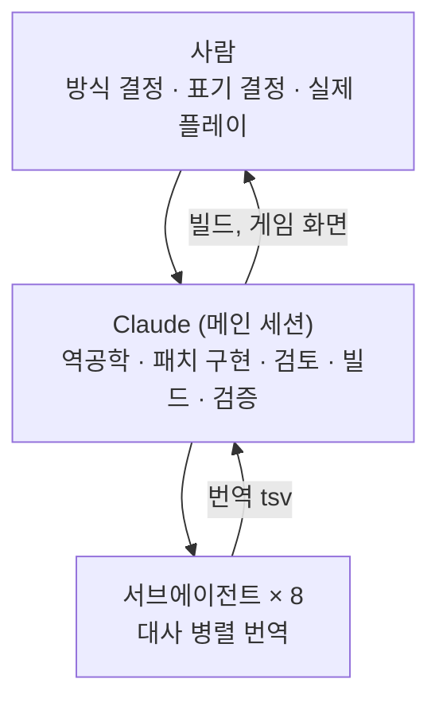

| 역할 | 담당 | 한 일 |
|---|---|---|
| 🧑 **작업 지휘** | 사람 | ROM 확장·완성형 방식, 글꼴(나눔고딕), 표기 결정, 실제 플레이와 피드백 |
| 🧠 **총괄** | Claude | 65816 역공학, 후킹·폰트·그래픽 패치, 추출·삽입 도구, 번역 검토, 자동 검증 |
| ✍️ **번역** | Claude 서브에이전트 | 번역 지침에 따라 대사를 파일별로 나눠 병렬 번역 |

AI가 낸 번역을 그대로 쓰지 않았습니다. 태그 순서, 완성형 여부, 줄 폭, 남은 가나·한자를 도구로 검사했고, 실제 게임 렌더러로 모든 대사를 출력해 화면으로 확인했습니다.

## 🛠️ 직접 빌드

<details>
<summary><b>빌드 방법 펼치기</b></summary>

| 준비물 | 내용 |
|---|---|
| Python 3 | `Pillow` |
| 원본 ROM | 저장소 루트에 `Dai-3-Ji Super Robot Taisen (J).smc` |
| 글꼴 | 나눔고딕(`NanumGothic.ttf`), 나눔스퀘어 ExtraBold(`NanumSquareEB.ttf`). 기본은 Windows 사용자 글꼴 폴더에서 찾고, 다른 곳에 있으면 환경 변수 `SRW3_FONTDIR`로 폴더를 지정 |

```bash
cd build
python srwtext.py build
```

결과는 `out/srw3_ko.smc`와 `out/srw3_ko.ips`에 생깁니다. 배포용 xdelta는 다음으로 만듭니다.

```bash
xdelta3 -e -9 -s "Dai-3-Ji Super Robot Taisen (J).smc" out/srw3_ko.smc srw3_ko.xdelta
```

- 번역은 `script/*.txt`의 `KO:` 줄을 고칩니다. 규칙은 각 파일 머리말에 있습니다.
- 분기 태그(`{if}` `{goto}` `{rand}` `{F8:..}`)와 `{END}` 위치가 원문과 다르면 빌드가 멈춥니다.
- 작업 인계 문서는 [HANDOFF.md](HANDOFF.md), 분석 문서는 `analysis/`에 있습니다.

</details>

## 📁 저장소 구성

```text
├── analysis/    ROM 분석 문서와 도구 (문자표, 포인터 조사, 65816 디스어셈블러, LZ 압축기)
├── build/       패치 빌드 (추출·삽입, 후킹·폰트, 스테이지 제목, 타이틀 로고)
├── script/      번역 스크립트 26개 (대사 dlg*, 이름 sys*, 창 레이아웃 lay*) — 원문(JP:)과 번역(KO:) 대조
├── tr/          번역 보조 도구와 번역 원본 tsv
├── tools/       Mesen2 자동 검증 Lua와 스크립트 생성기
├── dist/        배포 묶음의 README.txt와 OFL.txt
├── docs/images/ README 스크린샷
└── HANDOFF.md   작업 인계 문서
```

`script/`와 `tr/`에는 번역 대조와 검수를 위해 일본어 원문이 함께 들어 있습니다. 원본 ROM, 빌드 결과 ROM, 에뮬레이터는 저장소에 넣지 않습니다. 패치 파일은 Release 첨부로 배포합니다.

## 🔤 글꼴과 라이선스

한글 글꼴은 [나눔고딕](https://hangeul.naver.com/font)(대사·메뉴 12px, 스테이지 제목 15px)과 나눔스퀘어 ExtraBold(타이틀 로고)를 흑백 비트맵으로 변환해 넣었습니다. 두 글꼴은 NAVER가 SIL Open Font License 1.1로 배포하며, 저작권 표시와 라이선스 전문은 릴리스의 `OFL.txt`에 있습니다.

## ⚖️ 권리와 안내

- **제작 목적:** 제3차 슈퍼로봇대전을 좋아하는 한국 팬들을 위해 순수한 팬의 입장에서 만들었습니다. 상업적 목적이 없으며 무료로 제공합니다.
- **권리:** 원작과 등장 작품·캐릭터의 모든 권리는 각 권리자에게 있습니다. 이 패치는 비공식이며 권리자의 승인을 받지 않았습니다. 제작자는 이 패치에 대해 어떠한 배타적 권리도 주장하지 않습니다.
- **ROM 미포함:** 패치 파일만 배포하며 ROM은 배포하지 않습니다. 패치하려면 직접 가지고 있는 원본 ROM이 필요합니다.
- **제공 중단:** 권리자가 요구할 경우 패치 제공을 중단할 수 있습니다.
- **대응 속도:** 제작자는 직장을 다니는 평범한 직장인입니다. 문제 제보에 대한 대응이 늦을 수 있으니 양해 부탁드립니다.

## 📢 AI 사용 고지

이 프로젝트는 Anthropic의 AI 모델인 Claude를 이용해 작성·개발되었습니다.
책임은 작성자에게 있으며, Claude는 도구일 뿐 저작자나 기여자가 아닙니다.
